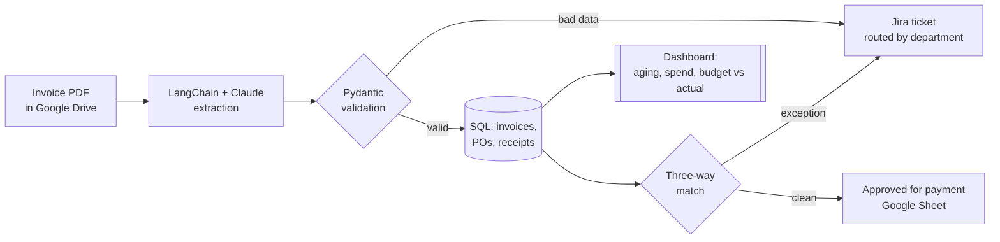
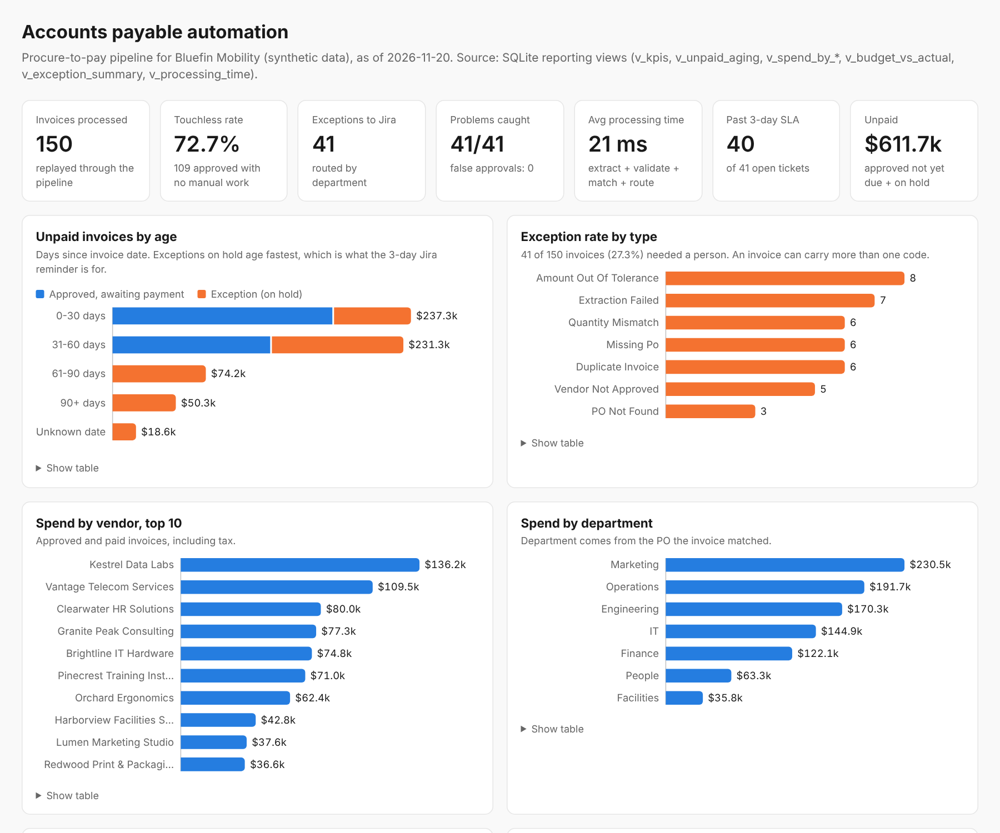
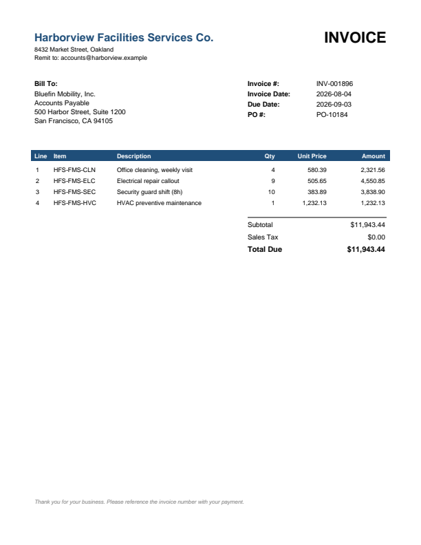
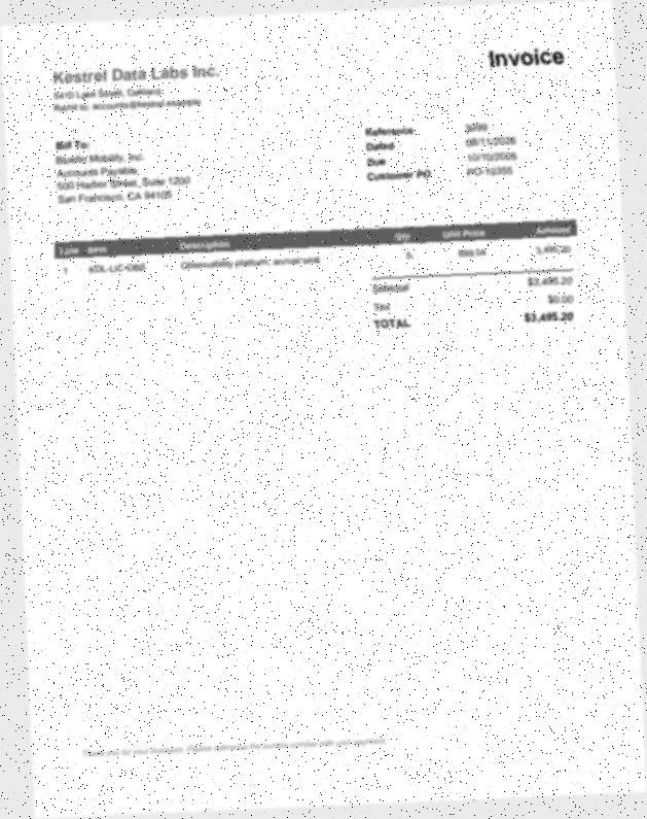

# AP Invoice Automation & Reconciliation

[](https://github.com/penguinme12345/AP-Invoice-Automation-Reconciliation/actions/workflows/ci.yml)


[](LICENSE)

**An end-to-end procure-to-pay pipeline: vendor invoice PDF in, three-way match in
SQL, clean invoices to the payment sheet, exceptions to Jira, and a dashboard on top.**

> 150 test invoices · **73% matched with no manual work** · **41 / 41 planted
> exceptions caught** · **0 false approvals** · ~25 ms per invoice ·
> runs offline with one command

Accounts payable teams check invoices against purchase orders by hand and chase
mismatches over email. This project automates procure-to-pay from the moment a
vendor invoice lands in a Google Drive folder to the dashboard that reports on it:



1. **Intake** – a new PDF in the Drive intake folder triggers the workflow (n8n, or Workato).
2. **Extraction** – LangChain + Claude reads the PDF (vendor, invoice #, PO #,
   dates, line items, totals).
3. **Validation** – Pydantic rejects bad extractions (missing fields, bad PO
   format, line math or totals that don't add up) instead of saving them.
4. **Three-way match in SQL** – invoice vs purchase order vs goods receipt:
   amount within ±2%, quantities received, currency, not a duplicate, vendor approved.
5. **Routing** – clean invoices go to an *Approved for payment* Google Sheet;
   exceptions become Jira tickets, routed by department, with high-dollar
   flags and a 3-day reminder.
6. **Dashboard** – unpaid invoices by age, spend by vendor and department,
   budget vs actual, exception rate and processing time.

A synthetic mini-ERP (vendors, POs, goods receipts, departments, budgets) for a
made-up company stands in for Oracle ERP, and every external service has an
offline mock, so **the whole thing runs with one command and no credentials.**

**Tech stack:** Python · LangChain (`langchain-anthropic`) · Claude · Pydantic v2 ·
SQL (SQLite, Postgres-ready) · pdfplumber · ReportLab · Jira Cloud REST API ·
Google Drive / Sheets APIs · n8n (Workato mapping) · pytest · GitHub Actions



*The generated dashboard (`outputs/dashboard.html`), built from the SQL reporting views.*

## Quick start

```bash
pip install -r requirements.txt      # Python 3.10+
python -m ap_automation demo         # or: make demo
python -m pytest                     # or: make test
```

`demo` generates the company and 150 invoice PDFs, runs them through the
pipeline in arrival order, sends SLA reminders, scores the run against ground
truth and builds the dashboard. It takes about 6 seconds.

```
== AP invoice automation demo (extractor: offline, as of 2026-11-20) ==
ERP loaded: 22 vendors, 162 POs, 155 goods receipts, 14 budget lines
Wrote 150 invoice PDFs to data/inbox
Processed 150 new invoices (150 in inbox): 109 approved for payment, 41 sent to Jira.
Simulated payment run: paid 82 approved invoices that reached their due date.
SLA job: 40 tickets open more than 3 days got a reminder

Matched 72.7% of 150 invoices with no manual work (109 auto-approved, 41 exceptions).
Caught 41/41 planted problems with the right code; false approvals: 0; overall accuracy 100.0%.
```

Outputs (all in `outputs/`): `dashboard.html`, `run_report.md`,
`approved_for_payment.csv` (the sheet), `jira_tickets.jsonl` (the tickets),
`bi/*.csv` (one file per reporting view for Looker Studio / Power BI).

## Results

From `outputs/run_report.md` (seed 42, offline extractor):

| Metric | Value |
|---|---|
| Invoices processed | 150 |
| Auto-approved with no manual work | 109 (72.7%) |
| Clean invoices auto-approved | 109 / 109 (100%) |
| Planted problems caught with the right exception code | 41 / 41 (100%) |
| False approvals (problem invoice sent to payment) | 0 |
| Avg processing time per invoice | ~25 ms offline |

The 27% exception rate is by design: 41 of the 150 invoices are deliberately
broken (below). How to read the numbers honestly:

- The offline extractor is a rule-based parser written for the three synthetic
  invoice layouts, so 100% here shows the **validation, matching and routing
  logic** is right, not that extraction is perfect on real-world PDFs. Run with
  `AP_EXTRACTOR=llm` for real vendor invoices (see below).
- The safety property that matters most for AP is **zero false approvals**:
  nothing broken reaches the payment sheet.

**Résumé bullet** (generated in `run_report.md` from the real run):

> Built an AP invoice automation pipeline using Python, LangChain and SQL that
> extracts invoice data, runs a three-way match against PO and receipt records,
> and sends exceptions to Jira with automated routing. It matched 73% of 150 test
> invoices with no manual work and flagged 41 of 41 planted exceptions
> (duplicates, missing POs, price and quantity variances, unapproved vendors,
> bad scans) with 0 false approvals.

## The tricky invoices

Sample PDFs of each case are in [`samples/invoices/`](samples/invoices/).

| Case | Count | How it's built | Caught by | Code |
|---|---|---|---|---|
| Clean (3 vendor layouts) | 99 | Matches PO and receipt exactly | – | approved |
| Small price variance | 10 | 0.3–1.6% over PO | within ±2% tolerance | approved |
| Missing PO number | 6 | PO line left off the invoice | SQL | `MISSING_PO` |
| Unknown PO | 3 | PO number not in the ERP | SQL | `PO_NOT_FOUND` |
| Duplicate | 6 | Vendor re-sends an invoice already processed, as a "payment reminder" | SQL (vendor + normalised invoice #, or vendor + date + total; the re-billed units also trip the cumulative quantity check) | `DUPLICATE_INVOICE`, `QUANTITY_MISMATCH` |
| Price out of tolerance | 8 | Unit prices 5–15% over PO | SQL | `AMOUNT_OUT_OF_TOLERANCE` |
| Short shipment | 6 | Bills full PO qty, receipt shows less | SQL | `QUANTITY_MISMATCH` |
| Unapproved vendor | 5 | Vendor is BLOCKED or PENDING in the vendor master | SQL | `VENDOR_NOT_APPROVED` |
| Blurry scan | 4 | Image-only PDF: low-res, rotated, blurred, speckled | No readable text | `EXTRACTION_FAILED` |
| OCR misread | 3 | Scan with a text layer where one digit in a line amount was misread | Pydantic: qty × price ≠ amount | `EXTRACTION_FAILED` |

| Clean invoice | Blurry scan |
|---|---|
|  |  |

## How it works

```
data/inbox/*.pdf ──► extraction.py ──► models.py ──► SQLite ──► three_way_match.sql ──► pipeline.py ──┬─► Sheet (approved)
 (Drive intake)      LangChain chain    Pydantic gate  invoices    one row per invoice   routing        └─► Jira (exceptions)
                                                                                                      views.sql ──► dashboard.py
```

| Module | What it does |
|---|---|
| `ap_automation/datagen.py` | Synthetic mini-ERP for *Bluefin Mobility, Inc.*: 7 departments with quarterly budgets, 22 vendors (3 not approved), POs, goods receipts, and the invoice plan with ground truth. Seeded, so numbers are reproducible. |
| `ap_automation/invoice_pdfs.py` | Renders the plan to PDFs in 3 vendor layouts (different labels and date formats), plus the bad-scan cases. |
| `ap_automation/extraction.py` | Two LangChain chains with the same interface: `llm` (Claude via `langchain-anthropic`, PDF sent as a document block, `with_structured_output(RawInvoice, method="json_schema")`) and `offline` (rule-based `RunnableLambda` over the text layer). |
| `ap_automation/models.py` | `RawInvoice` (what the extractor fills, all optional so the model can say "not found") and `Invoice` (strict, validated: required fields, PO format, line math, totals reconcile, dates). |
| `ap_automation/sql/schema.sql` | ERP tables + AP tables (`invoices`, `invoice_lines`, `match_results`, `exception_tickets`, `approved_for_payment`, `payments`, `pipeline_runs`). |
| `ap_automation/sql/three_way_match.sql` | The match: one CTE per control, one row per invoice with a flag per control and the exception codes. |
| `ap_automation/sql/views.sql` | Reporting views: aging, spend, budget vs actual, exception summary, processing time, KPIs. |
| `ap_automation/pipeline.py` | Orchestration, vendor-name resolution, idempotency (SHA-256 per file), routing. The simulated payment run (approved invoices marked paid on their due date) only runs in `demo`. |
| `ap_automation/integrations/` | `drive.py` (local folder / Drive API), `jira.py` (mock / Jira Cloud REST v3, routing rules, SLA reminders), `sheets.py` (CSV / gspread). |
| `ap_automation/dashboard.py` | Self-contained HTML dashboard over the views. |
| `ap_automation/evaluate.py` | Scores a run against ground truth, exports BI CSVs, writes the report. |

### Three-way match controls

| Control | Rule |
|---|---|
| PO present | `invoices.po_number IS NOT NULL` |
| PO exists | PO number found in `purchase_orders` |
| Vendor approved | resolved vendor exists and `vendors.status = 'APPROVED'`; PO belongs to the same vendor |
| Currency | invoice currency equals the PO currency (`CURRENCY_MISMATCH` otherwise) |
| Not a duplicate | no earlier invoice from the same vendor with the same normalised invoice number, or the same date and total |
| Amount | `|invoice subtotal − Σ(billed qty × PO unit price)| ≤ 2% × that value` (tax excluded) |
| Quantity | per PO line, units on this invoice plus units already billed on earlier approved invoices ≤ quantity received and ≤ quantity ordered; every billed line exists on the PO |

## Running with real services

Everything is configured with environment variables (see `ap_automation/config.py`).

| Step | Offline default | Live |
|---|---|---|
| Extraction | `AP_EXTRACTOR=offline` | `AP_EXTRACTOR=llm` + `ANTHROPIC_API_KEY` (model `AP_LLM_MODEL`, default `claude-opus-5-5`) |
| Intake | `data/inbox/` | `AP_DRIVE_MODE=live`, `DRIVE_INBOX_FOLDER_ID`, `GOOGLE_SERVICE_ACCOUNT_FILE` |
| Exceptions | `exception_tickets` table + `outputs/jira_tickets.jsonl` | `AP_JIRA_MODE=live`, `JIRA_BASE_URL`, `JIRA_EMAIL`, `JIRA_API_TOKEN`, `JIRA_PROJECT_KEY` |
| Approved sheet | `outputs/approved_for_payment.csv` | `AP_SHEETS_MODE=live`, `APPROVED_SHEET_ID`, `APPROVED_SHEET_TAB` |
| Business rules | ±2%, $10k, 3 days | `AP_TOLERANCE_PCT`, `AP_HIGH_DOLLAR`, `AP_SLA_DAYS` |

Google modes need `pip install -e ".[google]"` and the folder / sheet shared
with the service account. Jira setup and the automation rules are in
[`docs/jira_automation.md`](docs/jira_automation.md).

To try the LLM extractor on the demo set:

```bash
export ANTHROPIC_API_KEY=...
AP_EXTRACTOR=llm python -m ap_automation demo
```

Claude reads the PDF directly (text and images), so blurry scans that the
offline parser rejects may be extracted; the evaluation counts a correctly
matched blurry scan as a success in `llm` mode. Anything the model gets wrong
still has to pass the same Pydantic gate. This path has unit tests with a
stubbed model but has not been benchmarked against the live API yet.

## Orchestration: n8n, and how it maps to Workato

[`n8n/ap_invoice_workflow.json`](n8n/ap_invoice_workflow.json) imports into n8n
(Workflows → Import from file). Python does the parts that need code
(extraction, validation, SQL match) and returns one JSON outcome per invoice
(`run --json --integrations none`); the workflow does the SaaS steps, which is
how a Workato recipe would split the work too.

```
Drive trigger → Download → Save to inbox → Execute command (python) → Split items → IF clean?
                                                                           ├─ yes → Google Sheets: append row (RAW)
                                                                           └─ no  → Jira REST: create issue → link-ticket (key back to SQL)
Schedule (weekdays 7am) → Execute command: report
```

After import, attach Google Drive / Sheets / Jira credentials and replace the
`REPLACE_WITH_...` placeholders. Jira issues are created with an HTTP Request
node against the REST API so components can be set by name. In
`--integrations none` mode the pipeline still records each exception locally as
`LOCAL-<invoice_id>`, and the workflow's last step runs
`python -m ap_automation link-ticket <invoice_id> <JIRA-KEY>` so the dashboard
and SLA reporting see the real ticket. Sheet rows are appended as RAW values so
vendor-supplied text can never run as a formula.

| This project (n8n) | Workato equivalent |
|---|---|
| Workflow | Recipe |
| Google Drive Trigger "file created in folder" | Google Drive connector trigger *New file in folder* |
| Download file, Read/Write file | Google Drive *Download file* action |
| Execute Command running `python -m ap_automation run --json` | *Python* connector action, or an On-prem agent command / custom connector calling the pipeline as an HTTP service |
| Code node (split JSON into items) | Repeat (for each) over the JSON list, with a datapill per field |
| IF node `status == APPROVED` | IF condition step |
| Google Sheets *Append* | Google Sheets *Add row* |
| HTTP Request to Jira REST *Create issue*, then `link-ticket` | Jira *Create issue*, then a Python / on-prem step to record the key |
| Schedule Trigger | Scheduler trigger |
| Credentials | Connections |
| Execution log / retries | Job history, error monitor, *On error* retry block |
| Jira Automation rules (routing, high-dollar, 3-day reminder) | Stay in Jira, or a Workato scheduler recipe searching Jira with the same JQL |

Power Automate is the same shape: *When a file is created in a folder* → run a
script (Azure Function / desktop flow) → *Condition* → *Add a row* / Jira
connector *Create issue*.

## Documentation

- [Process maps, before and after](docs/process_maps.md)
- [Runbook](docs/runbook.md) – daily checks, what to do per exception code, troubleshooting
- [Jira setup and automation rules](docs/jira_automation.md)
- [Dashboard, Looker Studio and Power BI](docs/dashboard.md)

## Requirement coverage

| Requirement | Where it shows up |
|---|---|
| Python, automation | `ap_automation/` pipeline, CLI, orchestration |
| SQL, data validation and reconciliation | `sql/three_way_match.sql`, `sql/views.sql`, Pydantic gate |
| Workato or similar | `n8n/` workflow + Workato mapping above |
| LangChain, AI prototyping | `extraction.py` |
| Jira automation | `integrations/jira.py`, `docs/jira_automation.md` |
| Procurement, FP&A, financial reporting | POs, receipts, budgets, `v_budget_vs_actual` |
| Dashboards | `outputs/dashboard.html`, BI exports for Looker Studio / Power BI |
| Google Workspace, Excel | Drive intake, approved-for-payment sheet (CSV opens in Excel) |
| Testing | `tests/` (pytest) |
| Requirements gathering, process mapping | `docs/process_maps.md`, this README, runbook |

## Project layout

```
ap_automation/          package (python -m ap_automation ...)
  sql/                  schema, three-way match, reporting views
  integrations/         drive, jira, sheets (mock + live)
tests/                  pytest suite
docs/                   process maps, runbook, Jira rules, dashboard guide
n8n/                    importable n8n workflow
samples/invoices/       one PDF per scenario
data/, outputs/         generated (git-ignored)
```

## License

[MIT](LICENSE). All company, vendor and people names in the synthetic data are made up.
