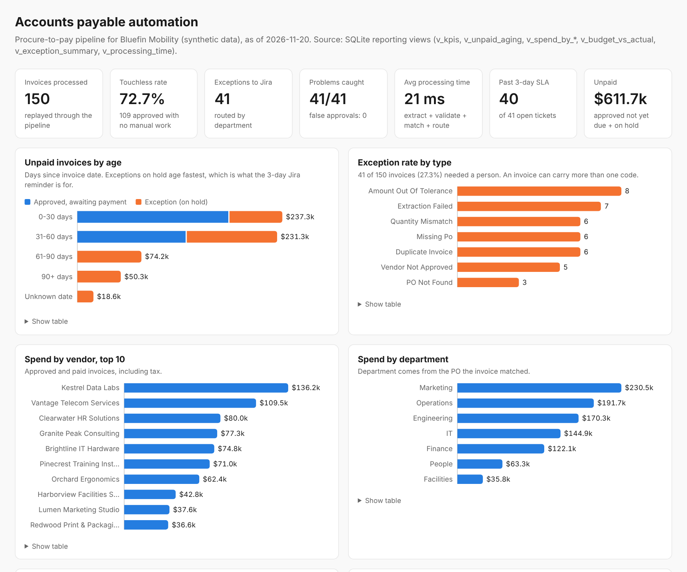

# Dashboard

`python -m ap_automation report` (also part of `demo`) writes
`outputs/dashboard.html`, a single self-contained file that opens in any
browser with no server. Every chart has a "Show table" view and hover
tooltips, and it follows the OS light/dark setting.

| Panel | View | What it answers |
|---|---|---|
| KPI tiles | `v_kpis` | Volume, touchless rate, exceptions, SLA breaches, unpaid amount |
| Unpaid invoices by age | `v_unpaid_aging` | How old is the money we still owe, and how much is stuck in exceptions? |
| Exception rate by type | `v_exception_summary` | Which controls fail most (where to fix the upstream process) |
| Spend by vendor | `v_spend_by_vendor` | Vendor concentration |
| Spend by department | `v_spend_by_department` | Who is spending |
| Budget vs actual | `v_budget_vs_actual` | FP&A view per department and quarter, with open PO commitments |
| Processing time | `v_processing_time` | Automated time per invoice and how long exceptions stay open |
| Open exception queue | `exception_tickets` | The AP team's worklist |

## Looker Studio

Looker Studio has no SQLite connector, so use one of:

1. **CSV / Google Sheets (fastest):** `outputs/bi/*.csv` has one file per view.
   Upload them to a Google Sheet (one tab per view) and add the Sheet as a data
   source. Re-run `report` and re-upload to refresh, or let the n8n "Weekdays
   7am" branch push them with a Google Sheets node.
2. **Postgres / BigQuery (production):** run the schema and views on Postgres
   (the SQL is ANSI apart from `julianday`/`strftime` date math) or load the
   CSVs to BigQuery, then use the native connector.

Suggested pages: Overview (KPI scorecards + aging stacked bar), Spend (vendor
and department bars with a quarter filter), FP&A (budget vs actual bullet or
combo bar), Operations (exception rate by code, ticket age).

## Power BI

1. Install the SQLite ODBC driver and add a DSN pointing to `data/ap.db`, or use
   **Get data → Text/CSV** on `outputs/bi/`.
2. Load the `v_*` views. Relate `v_invoice_detail.dept_id` to
   `v_budget_vs_actual.dept_id` (and `fiscal_quarter`).
3. Measures, for example:
   - `Touchless % = DIVIDE(COUNTROWS(FILTER(v_invoice_detail, [matched] = 1)), COUNTROWS(v_invoice_detail))`
   - `Over budget = SUMX(v_budget_vs_actual, MAX(0, [actual] - [budget]))`
