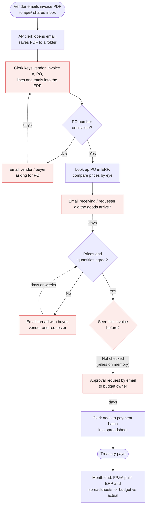
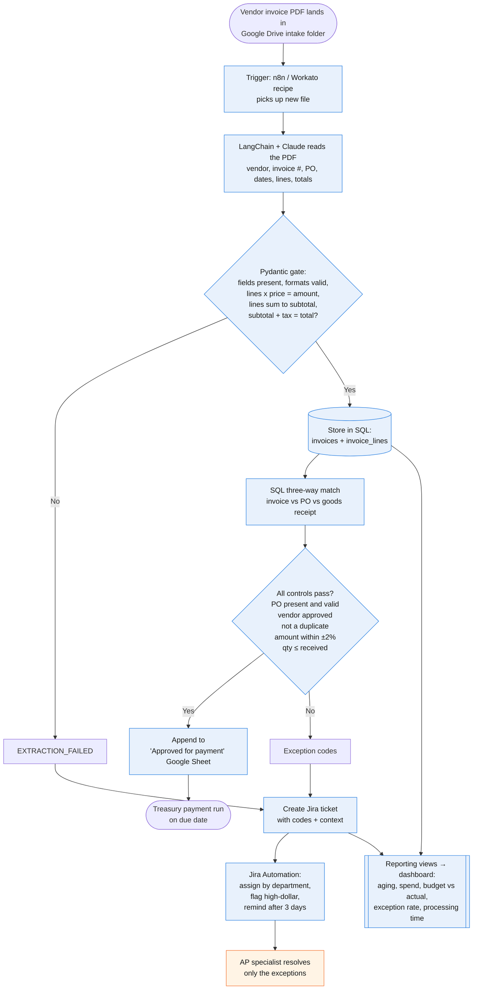
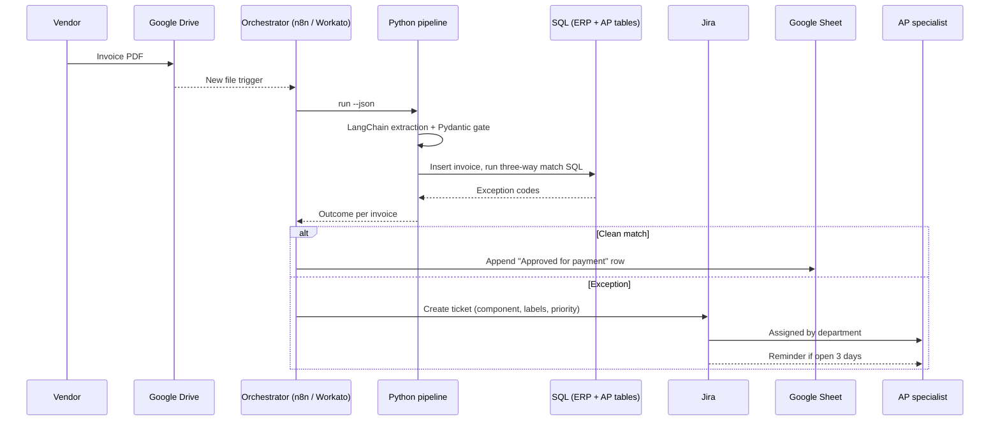

# Process maps: before and after

Procure-to-pay, from the moment a vendor invoice arrives to the moment it is
paid or resolved. The "before" map is the typical manual AP process this
project replaces; the "after" map is what the pipeline does.

## Before: manual three-way match

Pain points (red):

| Step | Problem |
|---|---|
| Manual keying | Slow, typos in amounts and PO numbers, no validation |
| Chasing POs and receipts | Done by email, no owner, no timer, no audit trail |
| Mismatch resolution | Lives in inboxes; nobody can see how many are stuck or for how long |
| Duplicate check | Depends on someone remembering; resent invoices get paid twice |
| Approval | Email approvals, hard to audit |
| Reporting | Spend and budget vs actual only at month end, assembled by hand |

## After: automated pipeline

What changed:

| Before | After |
|---|---|
| Every invoice touched by a person | Only exceptions are touched (27% of the demo set, all planted problems) |
| Keying errors go straight into the ERP | Bad extractions are rejected by the Pydantic gate and ticketed |
| Mismatches chased over email | Each mismatch is a Jira ticket with an owner, a priority and a 3-day reminder |
| Duplicate check by memory | Duplicate check in SQL against every invoice ever received |
| Month-end reporting | Dashboard over live SQL views, refreshed on every run |

## Swimlane view (who does what)

